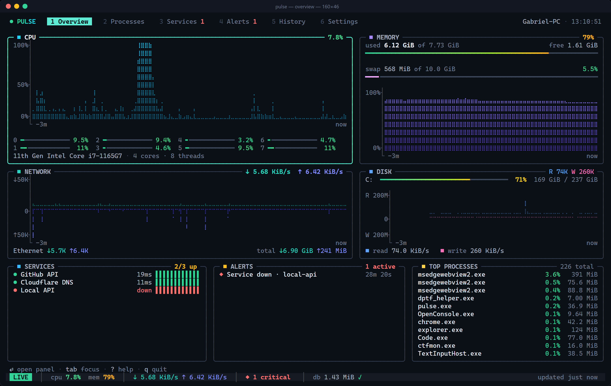
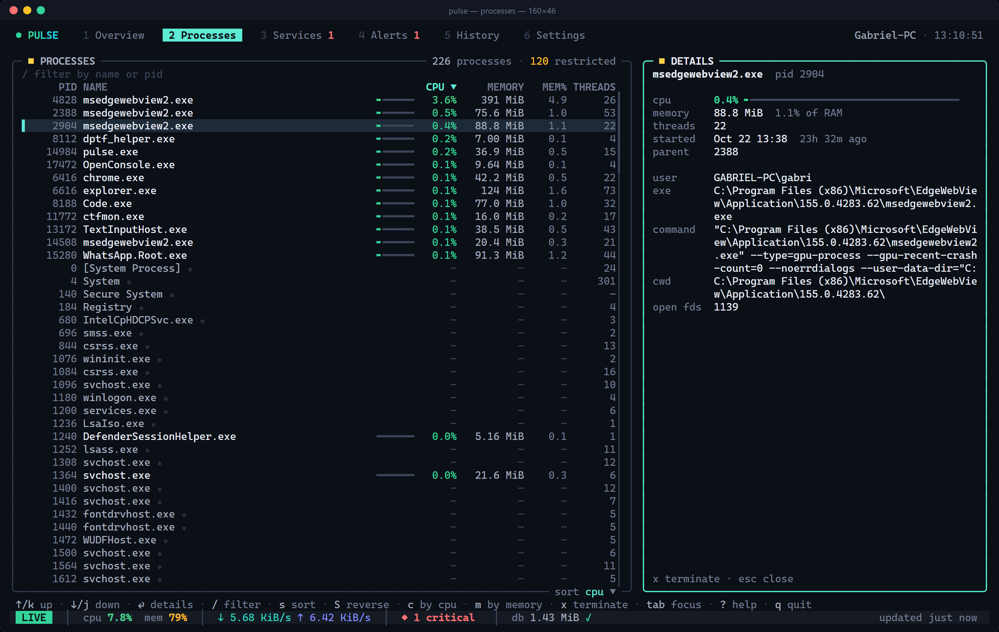
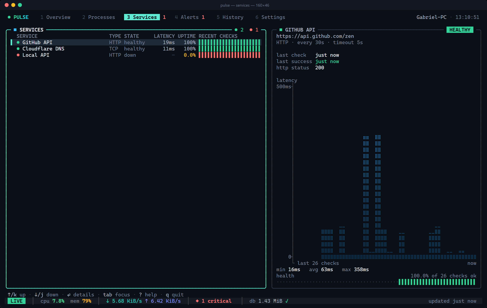
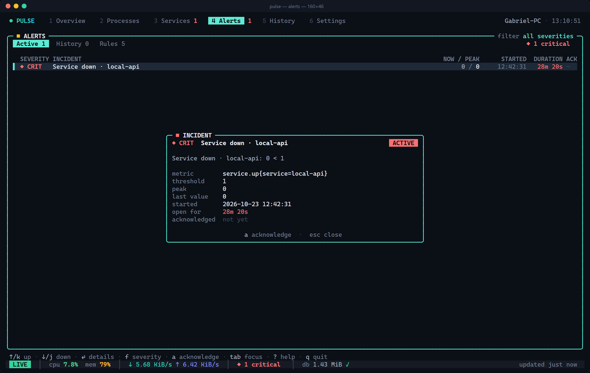
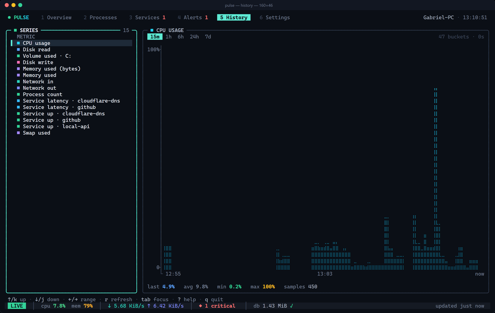

# pulse

Terminal system monitor written in Go. Shows CPU, memory, disk, network and processes,
checks HTTP/TCP services, fires alerts based on thresholds and keeps a local history in SQLite.

Works on Windows, Linux and macOS. Single binary, no CGO.



## Install

```bash
go install github.com/gabrielagostinho/pulse/cmd/pulse@latest
```

or build from source:

```bash
git clone https://github.com/gabrielagostinho/pulse
cd pulse
go build -o pulse ./cmd/pulse
```

Use a font with Braille glyphs for the charts (Cascadia Mono, JetBrains Mono, etc.).
If yours doesn't have them, set `ui.charts: blocks` in the config.

## Usage

```bash
pulse                         # start
pulse --config ./pulse.yaml   # custom config
pulse --db /tmp/pulse.db      # custom database path
pulse config init             # write the example config to the default location
pulse config validate         # validate config and exit
pulse config path             # show config and data paths
pulse snapshot --out shots    # render screens to .ans/.html
pulse version
```

### Keys

| Key | Action |
|---|---|
| `1`-`6` | switch screen (overview, processes, services, alerts, history, settings) |
| `[` `]` | previous / next screen |
| `tab` | move focus |
| `↑` `↓` `j` `k` | navigate lists |
| `enter` / `esc` | open / close details |
| `/` | filter processes (name or `pid:1234`) |
| `s` / `S` | change sort / reverse |
| `c` / `m` | sort by cpu / memory |
| `x` | kill process (asks first) |
| `a` | ack alert |
| `f` | filter alerts by severity |
| `←` `→` | history range |
| `r` | refresh |
| `p` | pause |
| `?` | help |
| `q` | quit |

## Screens

| | |
|---|---|
|  |  |
|  |  |

## Config

Runs fine without a config file. Run `pulse config init` to generate one, or check
[configs/config.example.yaml](configs/config.example.yaml) for all options.

Default locations:

- Windows: `%APPDATA%\Pulse\config.yaml`, data in `%LOCALAPPDATA%\Pulse\`
- macOS: `~/Library/Application Support/Pulse/`
- Linux: `$XDG_CONFIG_HOME/pulse/config.yaml`, data in `$XDG_DATA_HOME/pulse/`

You can override them with `PULSE_CONFIG`, `PULSE_CONFIG_DIR`, `PULSE_DATA_DIR` or the
`--config`, `--db`, `--log-file`, `--log-level` flags.

Example:

```yaml
services:
  targets:
    - id: api
      url: https://api.example.com/healthz
      interval: 15s
      timeout: 3s
      degraded_latency: 400ms
    - id: postgres
      type: tcp
      address: localhost:5432

alerts:
  rules:
    - id: cpu-high
      metric: cpu.usage
      operator: ">"
      threshold: 90
      for: 1m
      hysteresis: 10
      clear_for: 30s
      severity: warning
    - id: api-slow
      service: api
      condition: latency
      threshold: 800
      for: 2m
      severity: critical
```

Available metrics: `cpu.usage`, `cpu.core.usage`, `cpu.load1`, `mem.used_pct`,
`mem.used_bytes`, `swap.used_pct`, `disk.used_pct`, `disk.read_bps`, `disk.write_bps`,
`net.rx_bps`, `net.tx_bps`, `service.up`, `service.latency_ms`, `proc.count`.

A rule on `disk.used_pct` applies to every volume. Use `disk.used_pct{mount=/}` to target
a single one.

## Project layout

```
cmd/pulse            CLI entrypoint
internal/domain      metrics, processes, services and alert rules
internal/application hub, alert engine, history writer, service watcher
internal/collectors  gopsutil-based collectors and service probes
internal/scheduler   periodic jobs
internal/storage     sqlite storage and migrations
internal/config      config loading and validation
internal/tui         bubbletea UI
tests/integration    end-to-end tests
```

## Development

```bash
make test
make race    # needs cgo
make build
```
